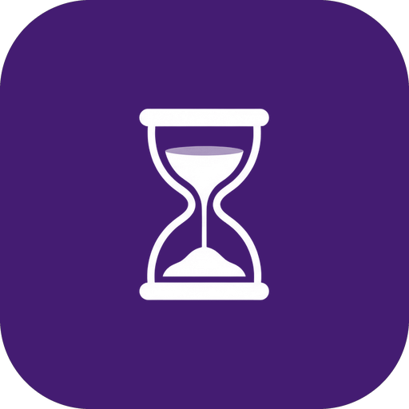

<p align="center">
  
</p>

<h1 align="center">Cadence</h1>

<p align="center">Tasks, calendar, Pomodoro focus, focus music and screen-break reminders in one calm app for Android and iPhone.<br>
Everything stays on your phone: no account, no server, no internet needed.</p>

<p align="center">
  
  
  
  
  
  
</p>

## Contents

- [Features](#features)
- [Using Cadence](#using-cadence)
  - [Home](#home)
  - [Tasks](#tasks)
  - [Calendar](#calendar)
  - [Focus](#focus)
  - [Settings](#settings)
  - [Insights](#insights)
- [How the timers work](#how-the-timers-work)
- [Default settings](#default-settings)
- [Achievements](#achievements)
- [Privacy](#privacy)
- [Android and iPhone](#android-and-iphone)
- [Permissions](#permissions)
- [Data](#data)
- [Project layout](#project-layout)
- [Build and run (Android)](#build-and-run-android)
- [Build and run (iPhone)](#build-and-run-iphone)
  - [Installing on an iPhone with a cable](#installing-on-an-iphone-with-a-cable)
- [Troubleshooting](#troubleshooting)
- [Supported versions](#supported-versions)

## Features

**In the app**

- **Tasks and calendar.** Tasks with schedules, due dates, priorities, categories, checklists and reminders. Month, week and day views. Tap a task card to open it. While you track actual time on a task, Home shows a live mm:ss counter (hours appear after the first hour); tap it to open the task.
- **Pomodoro timer and Focus Mode.** Focus sessions with short and long breaks, tied to a task if you like, with background music.
- **Do Not Disturb** (Android). Switches the phone's DND on while a focus session runs. Pausing, ending focus or starting a break puts DND back the way it was. Calls, repeat callers, messages and calendar events can still come through if you allow them.
- **App lock.** While a focus session runs, apps you haven't allowed show a lock screen. Pausing or ending focus unlocks them straight away. Calls, Settings, the home screen and Cadence are always allowed.
- **Screen breaks.** Reminders to rest your eyes. The break is a guided full-screen countdown: a breathing circle, four short steps, and **Complete break**, **Postpone** and **Skip**. It looks the same whether the app is open or closed, and it keeps its time when you rotate the phone. On Android, turning the screen off for at least the break length counts as a rest: the next break is a full interval after the screen comes back on. This works with the app open, in the background or closed (closed needs Usage access). iPhone can't detect the screen, so it uses a fixed schedule.
- **Vibration and sound.** Timer and screen-break alerts vibrate and play a sound. Vibration works even when the phone's touch feedback is off.
- **Focus music.** Built-in tracks generated on the device (lo-fi, ambient, rain, nature and more), plus your own uploads in any category, including *Others*, or a new category you create while uploading. **All** lists every track.
- **Insights and goals.** Focus time, tasks completed, streaks and charts, based only on your own activity.
- **Starts on Home.** When you open Cadence after closing it from Recents, it opens on the Home tab. Switching tabs also resets each tab to its default view.
- **Dashboard widgets.** The Home tab starts empty. **Customize** opens a widget gallery where you add widgets, or pin them straight to the phone's home screen on Android. In edit mode you can reorder or remove widgets, or reset the whole layout (Cadence asks first).

**Outside the app**

- **Home-screen widgets:** Focus timer, Today, Upcoming schedule, Deadlines, Daily progress, Weekly focus, Focus streak, Mini calendar, Focus music, Screen breaks and Daily quote. They update as soon as anything changes in the app, every minute during a focus session, and at midnight.
- **Full-screen alerts** when a focus session, break or screen break ends. They wake the screen, show over the lock screen or the app you're using, and play a sound with vibration.
- **Notifications** for task start and end times, deadlines, overdue tasks and the daily plan. They're scheduled with Android alarms, so they fire with the app closed and after a reboot.
- **Notification controls.** An ongoing timer notification (pause, resume, skip) and a music player in the notification shade.

Anything you do from a widget or notification is replayed into the app's data the next time it runs.

## Using Cadence

The bottom bar has five tabs. The chart button at the top opens Insights, and the bell opens your notifications.

### Home

- A greeting with today's date, and a card for the task you're tracking, if any. The card shows the time so far (mm:ss, then h:mm:ss after the first hour). Tap it to open the task.
- Your dashboard. It starts empty: tap **Customize** to add widgets from the gallery: Pomodoro Timer, Today's Tasks, Upcoming Schedule, Daily Progress, Upcoming Deadlines, Weekly Productivity, Focus Streak, Focus Music Player, Mini Calendar, Screen Break Status and Daily Motivational Quote. In edit mode, drag widgets to reorder them, remove them, or reset the layout. Leaving the tab or the app finishes editing.
- On Android, each widget in the gallery also has **Add to phone**, which pins it to the phone's home screen.

### Tasks

- Views: **All**, **Today**, **Upcoming** and **Overdue**, plus search, filters (priority, category, status) and sorting.
- A task has a title, description, start and end time, due date, priority, category (pick one or create a new one with its own color), time estimate, checklist, reminders and a status: *Pending*, *In progress* or *Completed*.
- Tap a card to open the task. The checkbox completes it, and the icon buttons focus on it with the Pomodoro timer, start or stop tracking actual time, postpone it or delete it.
- Completing a task shows an **Undo** snackbar.

### Calendar

- **Month**, **Week** and **Day** views. All three take the same height, so switching doesn't make the page jump.
- Tap the title between the arrows to jump to a date. Tap a day to see its tasks. The **+** button adds a task on the selected day.

### Focus

- The Pomodoro timer: focus, short break and long break, with dots showing where you are in the set. The icon buttons start, pause, reset and skip.
- **Do Not Disturb** and **Lock other apps** switches for the current session. They only take effect while a focus session is running.
- **Set up Focus Mode** combines a session length, a task, music, Do Not Disturb and the app lock in one step. While Focus Mode is on, **Modify** and **End** sit in the same row as the timer buttons.
- The focus music player: categories (**All**, **Favorites**, Lo-fi, Ambient, Rain, Nature, White Noise, Instrumental, Piano, Café, Ocean, Forest, Others and your own), with repeat, shuffle, favorites and volume. **Upload** in the top-right corner adds your own audio files.

### Settings

| Group | Sections |
| --- | --- |
| Personalize | **Appearance** (match device, light or dark), **General** (12/24-hour time, first day of the week, sounds, vibration) |
| Focus | **Pomodoro timer**, **Focus Mode** (Do Not Disturb, what gets through, allowed apps, auto music, time tracking), **Screen breaks**, **Break suggestions** (your own list of break ideas), **Music** (default category, volume, your uploads) |
| Alerts & goals | **Permissions**, **Notifications** (each kind on or off, reminder lead times, daily plan time), **Goals** |
| Data | **Data & storage**, **About Cadence** |

### Insights

Focus time, sessions, completed tasks, streaks and goal progress for the day, week, month or all time, with charts and achievements. All of it comes from your own activity on this phone.

## How the timers work

**Pomodoro.** A focus session is followed by a short break; every fourth session is followed by a long break instead. With *auto-transition* on, the next phase starts by itself. The timer runs natively, so it keeps going and ends on time with the app closed. When a phase ends you get a full-screen alert with sound and vibration.

**Screen breaks.** Cadence counts screen time and, after the interval (20 minutes by default), asks you to rest your eyes for the break length (20 seconds by default): the 20-20-20 rule. You can apply it to focus sessions only, general use only, or both. During a screen break the Pomodoro timer can pause and resume afterwards. **Postpone** delays the break by a few minutes and **Skip** starts a new interval. On Android, if the screen is off for at least the break length, that counts as a rest and the count starts over when the screen comes back on.

**Do Not Disturb and app lock** follow the focus timer: they switch on when a focus session starts running, and switch off (DND goes back to your previous setting) when you pause, start a break or end the session.

## Default settings

| Setting | Default |
| --- | --- |
| Focus / short break / long break | 25 / 5 / 15 min, long break every 4 sessions, auto-transition on |
| Screen breaks | On, every 20 min for 20 s, during focus and general use, postpone 5 min, pauses the Pomodoro timer |
| Do Not Disturb, app lock | Off until you grant the permission, then on by default. Calls, repeat callers and calendar events get through |
| Notifications | All kinds on, reminder 10 min before start, deadline warning 60 min before, daily plan at 9:00 AM |
| Sounds and vibration | On |
| Music | Lo-fi, volume 60%, pauses during breaks |
| Goals | 100 focus minutes a day, 10 focus hours and 10 tasks a week |
| Week starts on | Sunday |
| Theme | Match device |

## Achievements

First focus, Getting into rhythm (10 sessions), Steady cadence (25), Deep worker (100), Ten hours of focus, First tick, Momentum (10 tasks), Finisher (50), Three in a row and A full week (focus streaks), Goal reached (daily goal), Weekly goal, and Kind to your eyes (10 screen breaks).

## Privacy

- No account, sign-in, ads, analytics or tracking. Cadence makes no network requests.
- Built-in music is generated on the phone. Uploaded songs are copied into the app's private storage and never leave the phone.
- The installed-apps list and Usage access are only used to know which app is open during a focus session. On iPhone, Apple's Screen Time picker hides app names even from Cadence.
- Uninstalling Cadence deletes all its data. Use **Back up** first if you want to keep it.

## Android and iPhone

Both apps share the same interface code in `www/`. Each platform has its own native layer. iOS doesn't allow some Android behaviours, so the iPhone app uses the closest thing Apple allows:

| Feature | Android | iPhone |
| --- | --- | --- |
| Home-screen widgets (all 11) | App widgets, tappable buttons | WidgetKit widgets, tappable buttons (iOS 17+) |
| Running timer | Ongoing notification with Pause/Skip | Live Activity on the Lock Screen and Dynamic Island, with Pause/Skip |
| End of a session or break | Full-screen alert that wakes the screen | Full-screen alarm on iOS 26 (AlarmKit); time-sensitive notification on older iOS |
| Reminders and screen breaks while closed | Exact alarms | Scheduled local notifications (iOS keeps 64 at a time; the nearest ones are kept) |
| App lock | Lock screen over apps you didn't allow | Screen Time shield on apps you didn't allow, chosen in Apple's app picker |
| Do Not Disturb | Switched on and off automatically | **Not possible:** iOS doesn't let apps switch Focus. Cadence shows how to turn on a Focus from Control Center, and its alerts are time-sensitive so they get through. |
| Music controls outside the app | Notification-shade player | Lock Screen and Control Center Now Playing controls |
| "Add to phone" from the widget gallery | Pins the widget | Shows how to add it (iOS has no API for this) |

## Permissions

Cadence asks for each permission when you first use the feature that needs it. **Settings → Permissions** in the app lists them all with a switch each.

On iPhone the list is shorter: Notifications, Screen Time (app lock) and, on iOS 26, Alarms.

| Android permission | Used for |
| --- | --- |
| Notifications | Reminders, timers and screen breaks while the app is closed |
| Full-screen alerts | Waking the screen when a session or break ends |
| Display over other apps | Showing alerts and the app lock over the app that's open |
| Usage access | Seeing which app is open, to lock apps during focus |
| Do Not Disturb access | Silencing the phone during focus sessions |
| Exact alarms (automatic) | Firing timers and reminders on time |

Google restricts several of these on the Play Store, so publishing needs a justification for each in the store listing. Installing the app directly is not affected.

## Data

Data is stored on the device through Capacitor Preferences (SharedPreferences on Android, UserDefaults on iPhone). Widgets and extensions read a copy of the state the app publishes; on iPhone this copy is in the App Group `group.app.cadence.focus`. Uploaded music is copied into the app's private storage. **Settings → Data & storage** has **View stored data** (every section starts collapsed), **Back up** (save everything to a JSON file through the share sheet), **Restore**, **Clear activity history** and **Reset application data**. Tap a row to use it.

## Project layout

| Path | What it is |
| --- | --- |
| `www/` | The app interface: `index.html`, `style.css`, `script.js` (app logic), `audio.js` (music engine), `native.js` (device storage and the bridge to Android and iOS) |
| `android/` | The native Android project (Capacitor 8). Native code is in `android/app/src/main/java/app/cadence/focus/` |
| `ios/App/` | The native iOS project: `App/Native/` (app), `Shared/` (code shared with the extensions), `CadenceWidgets/` (widgets and Live Activity), `CadenceMonitor/` (Screen Time extension), `project.yml` (Xcode project definition) |
| `resources/icons/` | Logo artwork: `logo-source.png` (original), `logo-mark.png` (hourglass on transparent), `app-icon-512.png` |

The main native classes. Both platforms use the same names where the role is the same:

| Android | iOS | Role |
| --- | --- | --- |
| `CadencePlugin` | `CadencePlugin` | Bridge the app calls: sync state, permissions, app list, music files, widgets, vibration |
| `Controller` | `Controller` | Keeps alarms or notifications, DND, the app lock and widgets in step with the app's state |
| `TimerEngine` | `TimerEngine` | Native copy of the Pomodoro timer, so it keeps running while the app is closed |
| `AlertActivity` | `AlarmController` | Full-screen alert when a session or break ends |
| `AppLock`, `BlockActivity`, `FocusService` | `AppLock`, `CadenceMonitor` | App lock (and, on Android, background music) |
| `Dnd` | — | Turns DND on and off and restores your previous setting |
| `MusicSession` | `NowPlaying` | Music controls outside the app |
| `Widgets`, `MoreWidgets` | `CadenceWidgets`, `TimerLiveActivity` | Home-screen widgets (and the Live Activity on iPhone) |
| `ActionReceiver` | `CadenceActions` | Buttons in widgets and notifications |

## Build and run (Android)

Requirements: Node 18+ and Android Studio, or a JDK 21 plus the Android SDK. Set `JAVA_HOME` to the JDK, for example Android Studio's `jbr` folder.

```sh
npm install
npx cap sync android      # copy www/ into the Android project
npx cap run android       # build and install on a connected phone
# or open it in Android Studio:
npx cap open android
# or build an APK from the command line:
cd android && ./gradlew assembleDebug   # android/app/build/outputs/apk/debug/app-debug.apk
```

After changing anything in `www/`, run `npx cap sync android` again.

For a Play Store release, create a signing key, add a `signingConfigs` block to `android/app/build.gradle`, and run `./gradlew bundleRelease`.

To install on a phone without Android Studio, turn on USB debugging (Settings → About phone → tap *Build number* seven times, then Developer options → USB debugging), connect the phone and run `npx cap run android`. Alternatively, copy `app-debug.apk` to the phone and open it.

## Build and run (iPhone)

Requirements: a Mac with Xcode 16 or newer (Xcode 26 for the iOS 26 alarm), an Apple developer account, and [XcodeGen](https://github.com/yonaskolb/XcodeGen).

```sh
npm install
npx cap sync ios
brew install xcodegen
cd ios/App && xcodegen        # creates App.xcodeproj with the app, widget and Screen Time targets
open App.xcodeproj
```

In Xcode, set your **Team** under *Signing & Capabilities* for all three targets (App, CadenceWidgets, CadenceMonitor), then run on an iPhone. The Screen Time API doesn't work in the simulator. Run `xcodegen` again whenever you add or remove native files.

The capabilities come from the entitlement files: App Groups (`group.app.cadence.focus`) on all three targets, and Family Controls on the app and the Screen Time extension. For App Store distribution, Apple must approve the Family Controls entitlement. Request it at developer.apple.com before submitting.

> The iOS native code was written without access to a Mac and hasn't been compiled yet. Expect to fix a few build errors on the first Xcode build. The AlarmKit part (`AlarmController.swift`) only compiles with the iOS 26 SDK.

### Installing on an iPhone with a cable

1. Connect the iPhone to the Mac, choose it as the run destination in Xcode, and press **Run**.
2. On the iPhone, turn on **Settings → Privacy & Security → Developer Mode** (the phone restarts once).
3. Trust the developer profile under **Settings → General → VPN & Device Management**.

From a Windows PC, tools such as Sideloadly or AltStore can install a signed `.ipa` over USB. The `.ipa` itself must still be built on a Mac, a rented cloud Mac, or a macOS build service.

| Apple account | What you get |
| --- | --- |
| Free Apple ID | The app expires after 7 days and must be reinstalled. App Groups and Family Controls aren't available, so the widgets' shared data and the app lock don't work. |
| Apple Developer Program ($99/year) | All features. Installs last a year, and you can distribute through TestFlight or the App Store. |

## Troubleshooting

| Problem | What to do |
| --- | --- |
| Alerts or reminders are late or missing with the app closed | Allow **Notifications** and **Full-screen alerts** in Settings → Permissions. On phones with aggressive battery saving (HONOR, Huawei, Xiaomi, Samsung and others), set Cadence's battery use to *Unrestricted* or allow it to *run in background* / *auto-launch*. |
| Do Not Disturb doesn't switch on | Turn on **Do Not Disturb access** for Cadence. DND only applies while a focus session is *running*, not when it's paused or on a break. |
| Other apps aren't locked | Allow **Usage access** and **Display over other apps**, and make sure the app isn't in your allowed list. |
| Screen breaks don't reset when the screen is off | Allow **Usage access** so Cadence can see screen on/off times while it's closed. |
| A home-screen widget looks out of date | Open Cadence once; widgets refresh whenever the app saves. Some launchers delay widget updates on battery saver. |

## Supported versions

- Android 7.0 (API 24) and newer, built for Android 16 (API 36).
- iOS 17 and newer. The full-screen session alarm needs iOS 26.
